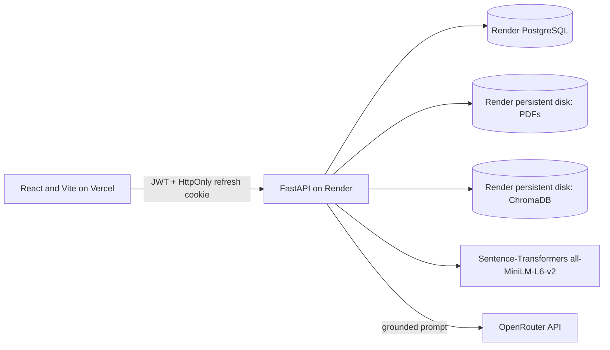
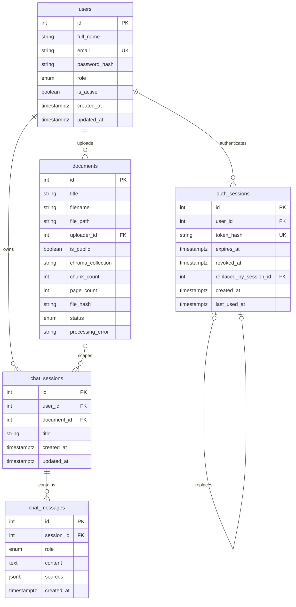

# Multi-Role RAG Chatbot

A document-grounded chatbot built with React, FastAPI, PostgreSQL, ChromaDB, Sentence-Transformers, and OpenRouter. Administrators manage users and PDF documents; users ask questions against public documents and view their own persisted chat history.

## Features

- **User:** register/sign in, manage profile and password, create document-scoped or all-accessible-document chats, view citations, and manage personal chat history.
- **Admin:** upload and remove PDFs, control public/private visibility, search and manage users, review aggregate statistics, and list chat sessions.
- **RAG:** PDF text extraction, 800-character chunks with 100-character overlap, local `all-MiniLM-L6-v2` embeddings, per-document persistent Chroma collections, globally ranked retrieval, and cited OpenRouter responses.
- **Security:** Argon2 password hashes, short-lived JWT access tokens, rotating HttpOnly refresh cookies, role guards, user/session ownership checks, upload validation, login/chat/upload rate limits, and last-active-admin protections.

## Architecture



The browser never receives the OpenRouter key. The backend uses the pinned OpenAI-compatible SDK and `https://openrouter.ai/api/v1`. The default model in the provided environment templates is the supplied free-tier `nvidia/nemotron-3-ultra-550b-a55b:free`; set `OPENROUTER_MODEL` to another model only if desired.

## Database diagram



The application keeps the four core tables (`users`, `documents`, `chat_sessions`, `chat_messages`) and the required refresh-token support table (`auth_sessions`).

## Prerequisites

- Windows 11, Python 3.11, Node.js, npm, and PostgreSQL 15 or newer
- PostgreSQL databases `rag_db` and `rag_test_db` (or equivalent isolated databases)
- An OpenRouter API key configured locally in `backend/.env`; never paste it into chat or commit it
- Internet access the first time the embedding model is downloaded

## Local setup

### Backend

From a Windows command prompt:

```bat
cd backend
py -3.11 -m venv venv
venv\Scripts\activate
python -m pip install -r requirements.txt
copy .env.example .env
```

Edit `backend/.env` on your computer. Configure `DATABASE_URL`, a strong random `JWT_SECRET`, and `OPENROUTER_API_KEY`. Admin requests submitted on the signup page remain inactive until an existing administrator reviews and activates them. Bootstrap the first administrator interactively with `python -m app.cli create-admin`. Keep the default `OPENROUTER_MODEL` for the supplied free-tier selection or set a model available to your OpenRouter account. Never add the key to a `VITE_` variable.

Create the local PostgreSQL databases and role using your PostgreSQL administrator, then check that `DATABASE_URL` targets `rag_db` and `TEST_DATABASE_URL` targets `rag_test_db`. Run migrations and create an administrator interactively:

```bat
alembic upgrade head
python -m app.cli create-admin
```

Start the API:

```bat
python -m uvicorn app.main:app --reload --host 0.0.0.0 --port 8000
```

Swagger UI is at `http://localhost:8000/docs`. The safe health probes are `/health/live` and `/health/ready`.

### Frontend

In a second command prompt:

```bat
cd frontend
npm ci
npm run dev
```

Open `http://localhost:5173`. The frontend reads the non-secret API base URL from `frontend/.env` (`VITE_API_URL=http://localhost:8000`). The access JWT lives in JavaScript memory only. Refresh credentials stay in an HttpOnly cookie and are rotated by the backend; this reduces persistent-token exposure, but the frontend must refresh after reload and production cookies require HTTPS and correct SameSite/CORS settings.

## Environment reference

| Setting | Purpose |
|---|---|
| `DATABASE_URL` | PostgreSQL connection string for the application |
| `TEST_DATABASE_URL` | Isolated test database; tests fail unless it targets `rag_test_db` |
| `JWT_SECRET` | Signing secret for access tokens |
| `OPENROUTER_API_KEY` | Backend-only OpenRouter credential |
| `OPENROUTER_MODEL` | OpenRouter model ID; the supplied environment template uses a free-tier model whose response speed and availability may vary |
| `OPENROUTER_BASE_URL` | OpenRouter-compatible API endpoint |
| `CORS_ORIGINS` | Comma-separated exact frontend origins |
| `CHROMA_PERSIST_DIR` | Persistent ChromaDB directory |
| `UPLOAD_DIR` | Persistent PDF directory |
| `MAX_UPLOAD_SIZE_MB` | Upload size limit (10 MB by default) |
| `RAG_TOP_K` | Number of globally ranked retrieved chunks (4 by default) |
| `RAG_DISTANCE_THRESHOLD` | Maximum Chroma cosine distance accepted for context |
| `COOKIE_SECURE`, `COOKIE_SAMESITE` | Refresh-cookie security attributes |

`backend/.env.example` and `frontend/.env.example` contain placeholders/configuration only. Real secrets belong in local ignored `.env` files or deployment-provider secret settings.

## Migrations and administration

From `backend/` with the virtual environment active:

```bat
alembic current
alembic upgrade head
alembic downgrade -1
python -m app.cli create-admin
```

The admin bootstrap prompts for email and password; no administrator password is hardcoded.

## Tests

From `backend/`:

```bat
venv\Scripts\python.exe -m pytest -q
```

The test fixture explicitly refuses to run unless `TEST_DATABASE_URL` contains `rag_test_db`. The suite uses mocks for OpenRouter and embeddings where appropriate; it does not make paid model calls. Tests cover auth, document validation and indexing lifecycle, access scope, chat ownership, admin last-account protection, Chroma persistence, and retrieval/citations.

From `frontend/`:

```bat
npm ci
npm run build
```

The current pinned frontend versions were required by the supplied stack. `npm audit --omit=dev` reports high-severity advisories in the pinned `axios@1.7.7` and `react-router-dom@6.27.0` dependency tree. They have not been upgraded because the project requirements explicitly pin those versions; review and approve a stack-version update before production use.

## Access and RAG behavior

- The signup page lets applicants choose `user` or `admin`. Admin signup requests remain inactive until approved by an existing administrator in the Users page; bootstrap the first administrator with `python -m app.cli create-admin`. Only admins can upload/delete documents or access `/api/admin/*`.
- Regular users can list/retrieve only ready, public documents. Admins can access public and private ready documents.
- A chat session may be scoped to a single accessible ready document; a null `document_id` searches all documents accessible to the caller. The backend revalidates both ownership and document access on every message request.
- Short standalone greetings (for example, `hello`) receive a conversational reply without document retrieval; document questions continue to use the grounded RAG flow.
- The local embedding model is loaded at backend startup rather than delaying the first document question.
- A foreign session or inaccessible document returns a generic 404. Admin session listings contain summaries only; message text is not exposed by that endpoint.
- Deleting a document deletes its stored PDF and Chroma collection; the database `ON DELETE SET NULL` behavior unbinds sessions while preserving their messages. The next message in that session searches current accessible documents.
- Uploads require a `.pdf` extension, `application/pdf` MIME, a `%PDF-` signature, valid parseable pages, and extractable text. Corrupt, encrypted, empty, duplicate, and oversized files are rejected. OCR is not included; image-only/scanned PDFs fail with a clear message.
- Each document is stored in `doc_{document_id}` with page, title, chunk index, and stable chunk ID metadata. Retrieval uses cosine distance (lower is closer), merges candidates across all authorized collections, and selects the best four below the configured threshold.
- `RAG_DISTANCE_THRESHOLD=1.2` is the current initial setting, not a universal quality guarantee. Before production, create a representative set of relevant and irrelevant questions, inspect observed cosine distances, choose a precision/recall tradeoff, and run the RAG tests with that corpus before changing this setting.
- Documents are treated as untrusted context. The system prompt instructs the model to ignore instructions contained in PDFs and cite only retrieved sources. Model output is not a substitute for a security or accuracy review.

## Deployment: Render backend + Vercel frontend

The Render blueprint is in `render.yaml`; it provisions a single Docker web service with a mounted persistent disk. Review the service plan and disk cost in Render before deploying. Set these values in Render's secret/environment settings:

- `DATABASE_URL`: Render PostgreSQL connection string (not localhost)
- `OPENROUTER_API_KEY`: rotated OpenRouter key
- `JWT_SECRET`: strong random secret
- `CORS_ORIGINS`: exact deployed Vercel origin, with no wildcard

`CHROMA_PERSIST_DIR=/var/data/chroma_db` and `UPLOAD_DIR=/var/data/uploads` are configured in the blueprint so both vectors and PDFs use the mounted disk. Do not horizontally scale this service while using one local persistent disk: it is a single-instance design and the disk is attached to one instance. The disk is not a backup; configure and test independent backups.

Before deploying, create/configure Render PostgreSQL and point `DATABASE_URL` to it. Build the service, then deliberately run the migration from Render Shell against the production database:

```sh
alembic upgrade head
```

Verify the migration and `/health/ready` before inviting users. Set the Vercel project root to `frontend/`; Vite is auto-detected. Configure `VITE_API_URL` to the HTTPS Render service URL. Configure Render `CORS_ORIGINS` to the exact Vercel HTTPS origin, `COOKIE_SECURE=true`, and `COOKIE_SAMESITE=none`. Do not put secrets in Vercel variables or `render.yaml`.

### Persistence, backup, and recovery

Render's mounted disk is required because ChromaDB and uploaded PDFs are local files. Without it, redeploys/restarts can lose both. PostgreSQL, PDFs, and Chroma data must be backed up together often enough to restore a consistent point in time; a database-only backup is incomplete. Before restoration, stop writes, restore PostgreSQL and both disk directories from the same recovery point, start one service instance, check health, and validate a known document retrieval. Test this recovery process before production. Disk failure or a bad deployment can reduce availability until the disk and database are restored.

### Vercel backend alternative

The project does not implement a Vercel serverless backend. Serverless filesystem storage is not a suitable persistent home for local ChromaDB and uploaded PDFs; using that route would require an explicitly approved storage architecture change.

## Current limitations

- Live deployment is not performed by this repository task; provider accounts, production PostgreSQL, exact Vercel origin, and secrets must be configured by the owner.
- The provided free-tier model was live-tested, but OpenRouter model availability and free-tier limits can change. The API reports errors instead of fabricating an answer.
- OCR for scanned PDFs is intentionally unsupported.
- The current file/vector cleanup and PostgreSQL deletion span multiple systems and cannot be one atomic transaction. Cleanup is ordered and retryable when database records remain, but operators should monitor failures and restore from coordinated backups.
- The configured distance threshold needs calibration against the project's real documents and questions.
